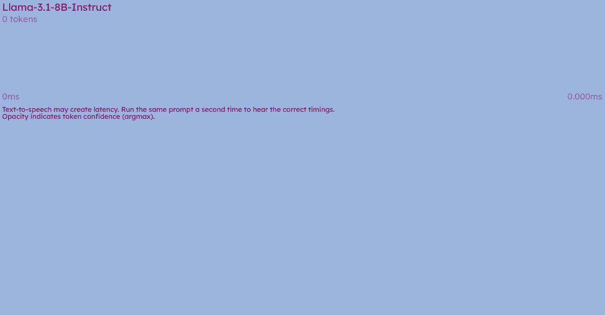

# AI Timescales

AI Timescales lets you listen to the timescales of inference and attention of two model architectures: autoregressive and diffusion language models.

<p align="center">
  
  
  
</p>

## Requirements

- Python 3.10–3.12
- Node.js 18+ and npm
- A HuggingFace token with access to [LLaMA 3.1 8B](https://huggingface.co/meta-llama/Llama-3.1-8B-Instruct) for best comparison with the diffusion model (LLaDa 8B-Instruct), or another AR-LM of your choosing.

---

## Installation

### 1. Python dependencies

Check the right PyTorch build for your system at [pytorch.org](https://pytorch.org/get-started/locally/), install it first, then:

```bash
pip install -r requirements.txt
```

### 2. Frontend dependencies

```bash
cd frontend
npm install
```
You may need to upgrade Node JS.

### 3. Environment variables

Create `.env`:

```env
HF_TOKEN='hf_...'          		# HuggingFace token
API_KEY='your_secret'      		# Shared secret between frontend proxy and backend
LOGIN_USER=""					# Username needed for login (optional)
LOGIN_PASSWORD=""				# Password needed for login (optional)
# DO_NOT_LOAD_AR=true    		# Skip loading AR
# DO_NOT_LOAD_DIFFUSION=true	# skip loading diffusion
# AR_MODEL="meta-llama/Llama-3.1-8B-Instruct"	# which AR-LM to use
# HF_HOME="path/to/huggingface/cache"			# set to current dir if absent
```

Copy `.env-example` into `.env` and set the credentials.

You'll need a HuggingFace token with access to the [Llama](https://huggingface.co/meta-llama/Llama-3.1-8B-Instruct) model. Request access on the model page if you don't have it yet.

Set `LOGIN_USER` and `LOGIN_PASSWORD` in `.env` if you want to enable the optional login.

---

## Running

### 1. Start the backend

```bash
cd backend
uvicorn backend:app --host 127.0.0.1 --port 8000 --workers 1
```

### 2. Start the frontend dev server

```bash
cd frontend
npm run dev
```

Then open **http://localhost:8080** in your browser.

The Vite dev server proxies all `/api/*` requests to the backend at `http://127.0.0.1:8000`, so no CORS configuration is needed.

### Production build (optional)

```bash
cd frontend
npm run build      # outputs to frontend/dist/
npm run preview    # serves the built output locally
```
